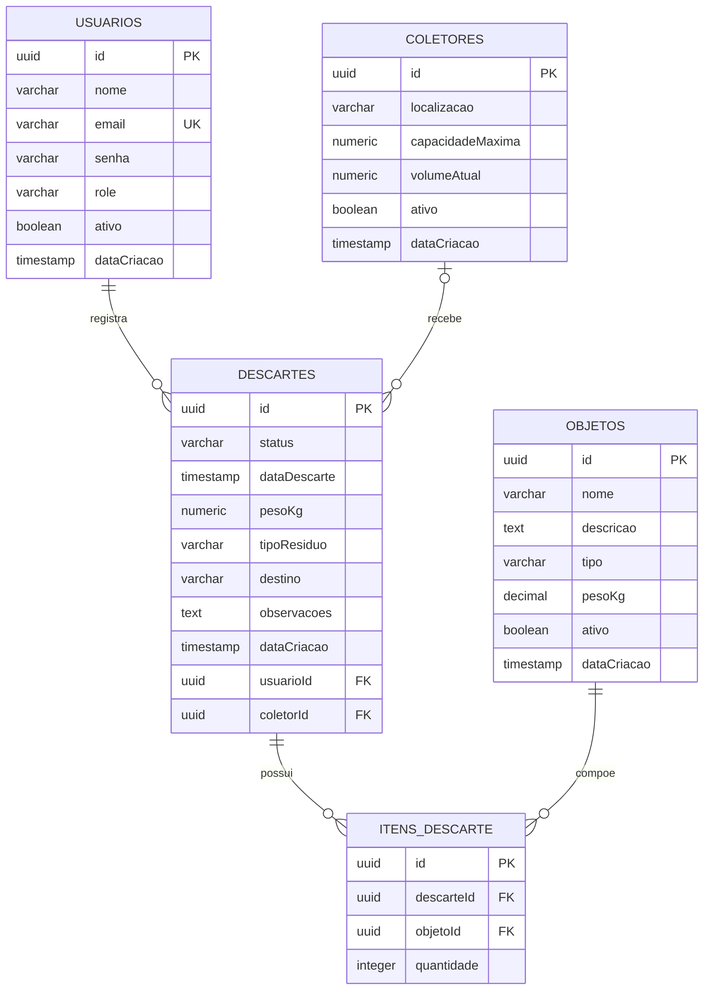

# Modelo de Dados — EcoCampusIFPE

## 1. Visão geral

O banco de dados do EcoCampusIFPE utiliza PostgreSQL e possui cinco tabelas principais:

- **usuarios:** armazena os usuários que registram descartes.
- **coletores:** representa os pontos físicos de coleta de resíduos.
- **descartes:** registra as operações de descarte realizadas.
- **objetos:** mantém o cadastro dos objetos que podem ser descartados.
- **itens_descarte:** relaciona os descartes aos objetos e registra suas quantidades.

## 2. Diagrama entidade-relacionamento

## 3. Descrição das entidades

### 3.1 Usuarios

Armazena os dados dos usuários do sistema.

| Campo | Tipo | Descrição |
|---|---|---|
| id | UUID | Identificador único (PK) |
| nome | VARCHAR(255) | Nome do usuário |
| email | VARCHAR(255) | E-mail único |
| senha | VARCHAR(255) | Senha armazenada |
| role | VARCHAR(50) | Perfil de acesso |
| ativo | BOOLEAN | Situação do usuário |
| dataCriacao | TIMESTAMP | Data de criação |

### 3.2 Coletores

Armazena informações sobre os pontos físicos de coleta.

| Campo | Tipo | Descrição |
|---|---|---|
| id | UUID | Identificador único (PK) |
| localizacao | VARCHAR(255) | Localização do coletor |
| capacidadeMaxima | NUMERIC(10,2) | Capacidade máxima |
| volumeAtual | NUMERIC(10,2) | Volume atual |
| ativo | BOOLEAN | Situação do coletor |
| dataCriacao | TIMESTAMP | Data de criação |

### 3.3 Descartes

Registra as operações de descarte realizadas pelos usuários.

| Campo | Tipo | Descrição |
|---|---|---|
| id | UUID | Identificador único (PK) |
| status | VARCHAR(50) | Situação do descarte |
| dataDescarte | TIMESTAMP | Data do descarte |
| pesoKg | NUMERIC(5,2) | Peso total em quilogramas |
| tipoResiduo | VARCHAR(50) | Tipo de resíduo |
| destino | VARCHAR(100) | Destino do resíduo |
| observacoes | TEXT | Observações adicionais |
| dataCriacao | TIMESTAMP | Data de criação |
| usuarioId | UUID | Referência ao usuário (FK) |
| coletorId | UUID | Referência ao coletor (FK, opcional) |

### 3.4 Objetos

Armazena os tipos de objetos que podem ser registrados nos descartes.

| Campo | Tipo | Descrição |
|---|---|---|
| id | UUID | Identificador único (PK) |
| nome | VARCHAR(255) | Nome do objeto |
| descricao | TEXT | Descrição do objeto |
| tipo | VARCHAR(50) | Categoria do objeto |
| pesoKg | DECIMAL(5,2) | Peso em quilogramas |
| ativo | BOOLEAN | Situação do objeto |
| dataCriacao | TIMESTAMP | Data de criação |

### 3.5 Itens de descarte

Tabela intermediária que relaciona os descartes aos objetos. Permite que um descarte contenha vários objetos e que um mesmo objeto apareça em diferentes descartes.

| Campo | Tipo | Descrição |
|---|---|---|
| id | UUID | Identificador único (PK) |
| descarteId | UUID | Referência ao descarte (FK) |
| objetoId | UUID | Referência ao objeto (FK) |
| quantidade | INTEGER | Quantidade de objetos descartados |

## 4. Relacionamentos

- Um usuário pode registrar vários descartes.
- Cada descarte pertence a um usuário.
- Um coletor pode estar associado a vários descartes.
- Um descarte pode não possuir um coletor associado.
- Um descarte pode conter vários itens.
- Um objeto pode aparecer em vários itens de descarte.

## 5. Regras de integridade

- O e-mail do usuário deve ser único.
- A combinação de descarte e objeto deve ser única em `itens_descarte`.
- A quantidade de cada item deve ser maior que zero.
- Um usuário com descartes registrados não pode ser excluído.
- A exclusão de um coletor mantém os descartes, removendo apenas sua referência.
- A exclusão de um descarte também exclui seus itens.
- Um objeto associado a itens de descarte não pode ser excluído.

## 6. Observação sobre as migrations

A estrutura inicial da tabela `coletores` possuía outros campos, que foram posteriormente tornados opcionais. A migration seguinte acrescentou `localizacao`, `capacidadeMaxima` e `volumeAtual`.

A migration `PreserveDisposalHistory` alterou a regra de exclusão de usuários, substituindo `CASCADE` por `RESTRICT`.

Este documento representa o modelo de domínio atual, considerando as entidades e as alterações realizadas pelas migrations.